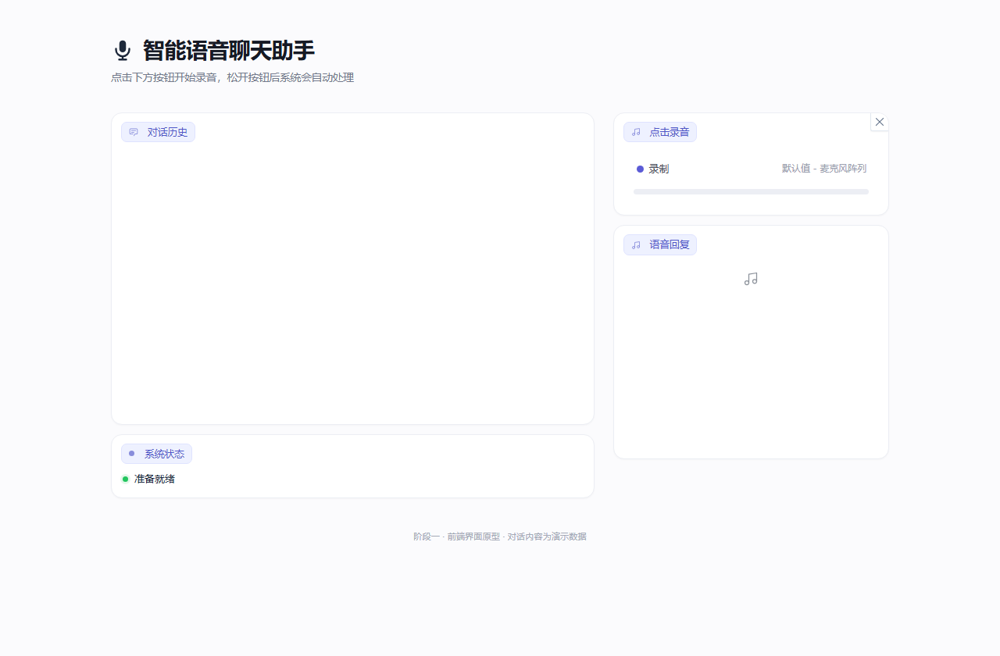
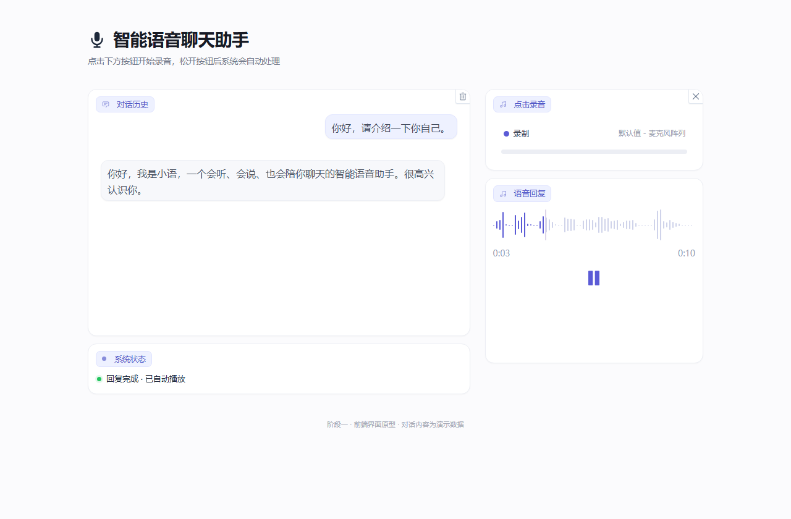
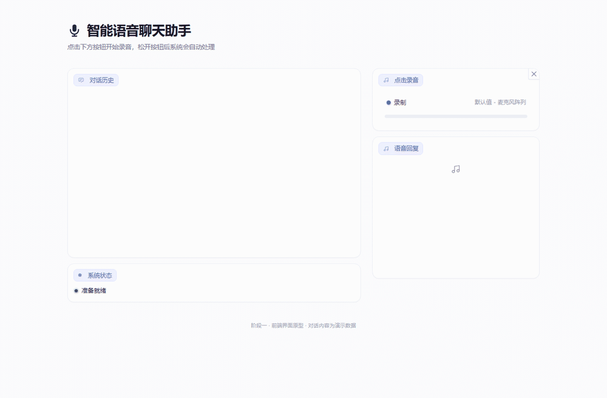

# 智能语音聊天助手 · 前端（阶段一）

Gradio 5.50 实现的语音聊天界面，已接入阶段二真实后端：

```text
浏览器录音
  → POST /asr   SherpaASR → 文本
  → POST /chat  DeepSeek  → 回复
  → POST /tts   EdgeTTS   → MP3
  → 界面气泡 + 自动播放
```

后端接口文档：[../../backend/stage2/阶段二-接口与部署文档.md](../../backend/stage2/阶段二-接口与部署文档.md)  
总项目说明：[../README.md](../README.md)

---

## 界面预览

| 初始界面 | 对话结果 |
| --- | --- |
|  |  |



> 截图是早期布局演示内容；布局、组件不变，接入后对话来自真实 ASR / DeepSeek / TTS。

更多：[录音中](screenshots/02-录音中.png) · [识别处理中](screenshots/03-识别处理中.png) · [原始参考图](screenshots/00-参考示例.jpg)

---

## 运行

共享 venv 在项目根目录，前端也使用它：

```powershell
cd F:\PBL\voice-assistant

# 1) 后端
.\.venv\Scripts\python.exe .\backend\stage2\run_services.py

# 2) 前端
.\.venv\Scripts\python.exe .\frontend\app.py
```

打开 <http://127.0.0.1:7860>。

或者一键启动：

```powershell
cd F:\PBL\voice-assistant
python start_all.py
```

### 环境变量

| 变量 | 默认 | 说明 |
| --- | --- | --- |
| `STAGE2_API_BASE` | `http://127.0.0.1:8010` | 后端 ASR/LLM/TTS 地址 |

### 依赖

前端依赖为 `gradio==5.50.0`、`requests==2.34.2`，已安装到共享 venv。重新安装：

```powershell
cd F:\PBL\voice-assistant
.\.venv\Scripts\python.exe -m pip install -r .\requirements.txt --cache-dir F:\PBL\.cache\pip
```

> 共享 venv 的 pydantic 是 2.12.3（Gradio 5.50 的上限）；升级后端依赖时不要破坏这个约束。

---

## 目录

```text
frontend\
├─ app.py             # 页面 + 阶段二 API 调用（/asr /chat /tts）
├─ styles.css         # 主题、卡片、标签、播放器
├─ screenshots\       # 布局/交互截图
├─ outputs\           # 运行时 TTS MP3 与集成记录
├─ requirements.txt
└─ README.md
```

运行时临时目录在 `.runtime/`；`GRADIO_TEMP_DIR`、`TMP`、`TEMP`、`tempfile.tempdir` 都指向项目内，避免写 C 盘。

---

## 交互流程

1. 点击「录音」，授权麦克风，显示计时/波形。
2. 点击「停止」后状态依次变为：
   - `正在识别语音（阶段二 ASR）…`
   - `正在生成回复（DeepSeek）…`
   - `正在合成语音（阶段二 TTS）…`
   - `回复完成 · 已自动播放`
3. 左侧显示真实用户文本和 DeepSeek 回复；右侧播放 EdgeTTS 的 MP3。
4. 录音卡片自动复位；对话历史右上角可清空。

阶段二未启动或接口报错时，状态卡会显示错误原因，不会回退到假数据。

---

## 实现要点

- 布局：`gr.Blocks` + 两列 `gr.Row`（7:4），浅紫徽标/白卡片。
- 录音：Gradio 原生 `Audio` 的 `start_recording` / `stop_recording`。
- 后端：`requests` 调 8010 的 `/asr`、`/chat`、`/tts`。
- 状态：生成器逐步刷新 `gr.HTML` 状态点与文案。
- 播放器：隐藏 Gradio 5.50 内部重复的原生 `<audio>`，保留自带播放键。
- 多轮上下文：Chatbot 历史传给 `/chat`，最多最近 10 条。

---

## 已知限制

- 依赖阶段二服务；后端未启动时界面只显示错误。
- 8010/8000 无鉴权、无 TLS，只适合本机/局域网。
- 阶段二未部署到 A3；当前为本地 LAN 地址（192.168.0.110）。
- 截图中的设备名来自无头 Chrome 虚拟麦克风，实机显示真实设备。
- 前端 7860 默认只绑定 `127.0.0.1`；局域网访问需要改 `server_name`。
